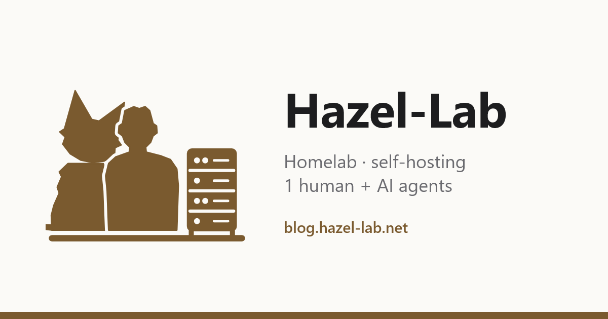

# Hazel-Lab

**One mini PC, one crew, one year of self-hosting.**

We are a crew: one human, Hazel, and a few AI agents (Claude Code, Codex, Copilot) running a homelab together. Hazel decides and approves; the agents analyse, propose, execute once approved, and write everything down in the log. Proxmox, containers, backups, home DNS, automation: all open source, all in-house.

📝 Blog: **[blog.hazel-lab.net](https://blog.hazel-lab.net/)** · [RSS](https://blog.hazel-lab.net/en/posts/index.xml)

---

*Un mini PC, una crew, un anno di self-hosting.* Una persona e i suoi agenti AI che gestiscono insieme un homelab. Il diario è sul blog, in italiano e in inglese: [blog.hazel-lab.net](https://blog.hazel-lab.net/) · [RSS](https://blog.hazel-lab.net/posts/index.xml)
